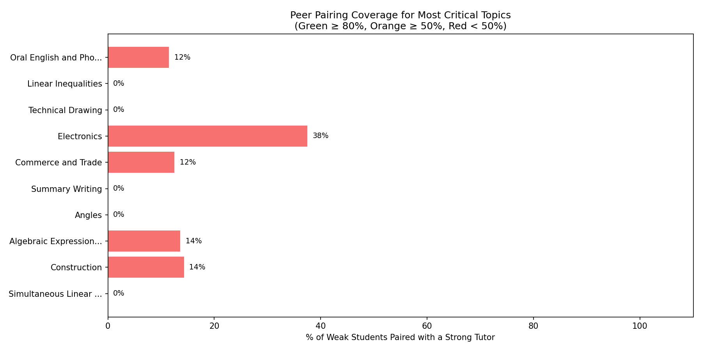
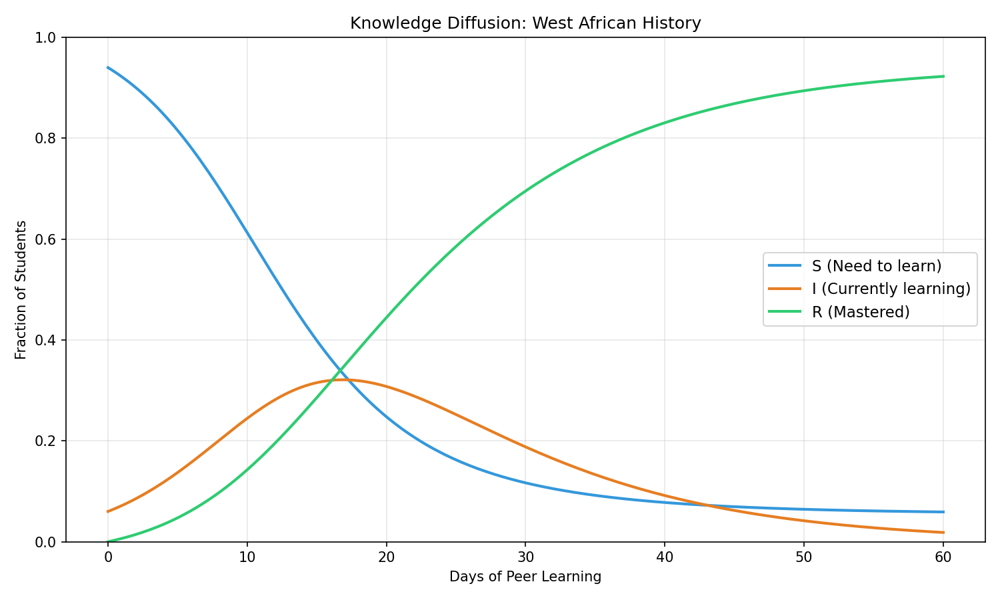
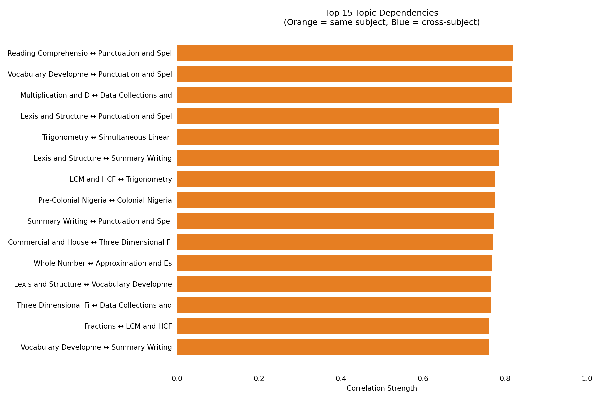
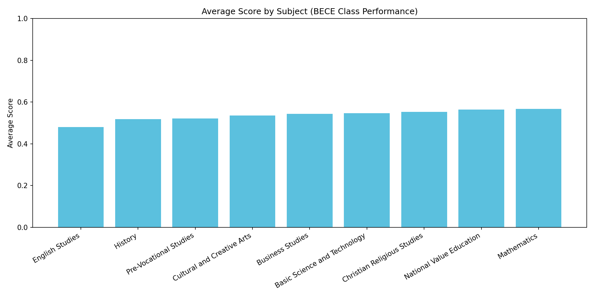

# BECE Social Learning Network (BECE-SLN)

[](https://github.com/Sommi33/bece-sln/actions/workflows/docker-ci.yml)


**Using Graph Analytics, Epidemiological Diffusion Models, and Containerized Microservices to Optimize Peer Learning in BECE Preparation**

Developed as a final-year BSc Information Technology research project at Redeemer's University, Ede, Nigeria, and engineered for cloud-native deployment.

---

## Overview

BECE-SLN replaces random study group assignment with graph-driven peer optimization for JSS3 students preparing for the Basic Education Certificate Examination (BECE). By modeling student mastery across 80 curriculum topics in **Neo4j AuraDB**, the system computes pairwise complementarity scores, uncovers prerequisite topic failure dependencies, simulates knowledge spread via **SIR epidemiological diffusion**, and serves live insights through a containerized **Flask + Gunicorn** REST API and interactive analytics dashboard.

---

## Cloud & System Architecture

- **Graph Database:** Neo4j AuraDB (Cloud-hosted property graph with uniqueness constraints and weighted relationships)
- **Backend & Analytics Engine:** Python 3.12, Flask, Gunicorn WSGI server, NetworkX, SciPy, scikit-learn, Pandas
- **Frontend Dashboard:** Interactive single-page analytics dashboard (`dashboard.html` + Chart.js)
- **Containerization & Security:** Hardened `python:3.12-slim` Docker image running as a non-root user (`appuser`) with automated `/api/health` readiness probes
- **CI/CD Automation:** GitHub Actions pipeline (`docker-ci.yml`) validating container builds and security posture on every push

---

## Graph Data Model

- **50 `Student` nodes** across performance tiers (`struggling`, `average`, `strong`)
- **80 `Topic` nodes** spanning **9 `Subject` nodes** (Mathematics, Basic Science & Technology, English Studies, Business Studies, National Value Education, Cultural & Creative Arts, Pre-Vocational Studies, History, Christian Religious Studies)
- **4,000 `SCORED` relationships** capturing weighted topic-level mastery
- **`COMPLEMENTARY_TO` & `DEPENDS_ON` relationships** generated via complementarity matrix and predictive dependency modeling

---

## Graph Analytics Results

| Peer Pairing Coverage | SIR Knowledge Diffusion (Hardest Topic) |
| :---: | :---: |
|  |  |

| Topic Failure Dependencies | Subject Performance Distribution |
| :---: | :---: |
|  |  |

---

## Quick Start (Docker)

1. **Configure Environment:** Create a `.env` file in the root directory:
   ```env
   NEO4J_URI=neo4j+s://<your-instance-id>.databases.neo4j.io
   NEO4J_USERNAME=<your-username>
   NEO4J_PASSWORD=<your-password>